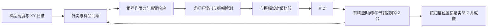

# AFM 交互教学演示：可行性分析与 Unity 实现方案

日期：2026-10-27

状态：本文保留 2026-10-27 的设计依据；2026-10-28 已实现 Windows 教学首版。当前运行方法、模型调整与验证证据见 [工程说明](../README.md) 和 [首版验收记录](../Reports/acceptance.md)。下文“尚未”等描述指方案形成时的状态。

## 1. 结论与定位

适合用 Unity 实现。建议做成一个共享仪器模型、分三步展开的虚拟实验台：**光杠杆读出 → 针尖受力与振动 → 振幅反馈扫描成像**。

教学目标是让学习者能够解释：悬臂为什么弯曲，探测器到底测到了什么，控制器保持哪个量不变，以及扫描图像为什么可能不等于真实表面。采用能解释这些因果关系的简化物理模型，不以复现某台商业 AFM 的定量测量精度为目标。

首版选用振幅调制 AFM（AM-AFM）。暂不加入频率调制 AFM、PLL、多模态振动、有限元、真实压电迟滞及材料参数反演。它们各自需要额外模型和标定，不能直接附在同一个“振幅或频率”选项上。

工作区已有 FactoryTwin、OdysseyNostos 等工程，两个工程的 ProjectVersion.txt 均为 Unity 6000.5.7f1。未发现专用 AFM 工程；本次检查未发现运行中的 Unity Editor，也未发现可调用的 Unity MCP 工具。因此本次只形成方案。后续建议在 `E:\UnityProjects\AFMTeachingLab` 创建独立工程，先交付 Windows 版本。

## 2. 必须讲清楚的物理概念

### 2.1 悬臂、针尖与反射面

结构应画成“一端固定的细长悬臂，末端下方带一个针尖”。激光照射悬臂背面靠近自由端的位置。可以把反射区域做成醒目的银色小片作为视觉提示；计算上不引入一个额外的厚重镜块。商用探针存在背面金属反射涂层。[Nanosurf 原理说明](https://www.nanosurf.com/en/support/how-does-afm-work)

光杠杆主要响应激光照射处的**局部斜率**，再通过已知梁形或标定换算为针尖位移。不能只让整个悬臂绕根部刚性旋转，也不能直接把针尖高度当作探测器光斑坐标。

### 2.2 三种基准不能混用

| 名称 | 含义 | 演示中的处理 |
|---|---|---|
| 光路零点 | 无外载、未接近样品时的光斑基准与探测器偏置 | 手动“设为光路零点”；不会每帧更新 |
| 静态偏转设定值 | 接触模式中希望维持的悬臂偏转，在线性近似下对应力 | 作为简短桥接说明；不另做一套完整接触模式扫描 |
| 振幅设定值 | AM-AFM 中希望维持的振动幅值，通常写为 Aset/A0 | 闭环扫描实际使用的目标 |

接触模式维持偏转，AM-AFM 维持振幅，这是不同的反馈量。[Park Systems 接触模式说明](https://www.parksystems.com/content/dam/parksystems/product/research-afm/afmmodes/contact-mode/ModeNote_Contact_mode_Park_Systems.pdf)、[AM-AFM 实验系统的反馈回路](https://pmc.ncbi.nlm.nih.gov/articles/PMC3701170/)

在振动状态下，光斑围绕平均位置往复运动；振幅回到设定值，不意味着每一时刻的光斑都回到零点。界面分别标记光路零点、当前平均位置和振幅包络。

### 2.3 Z 轴不是万能的“消力器”

如果手动外力 F 与针尖—样品间距无关，移动样品台不一定能改变 F，因而不能保证把偏转调回零点。光杠杆步骤先作为开环加载实验。闭环步骤则使用随间距变化的针尖—样品相互作用力。

### 2.4 “振幅改变”不必等于“耗散变大”

Lennard-Jones（LJ）势本身是保守势。针尖作用可以改变有效刚度和非线性响应，使固定驱动频率下的振幅、相位改变；这不等同于加入了额外耗散。若未来加入接触耗散，应有独立、明确的耗散力模型。

固定频率驱动的 AM-AFM 中，相互作用可使共振位置偏移，但驱动频率并不会自动跟随它。频率调制模式需要额外的频率跟踪与振幅控制，首版不做。[FM/PM 模式的回路结构示例](https://www.beilstein-journals.org/xiv/download/pdf/202218-pdf)

## 3. 最小但完整的教学内容

| 步骤 | 学习者操作 | 同屏观察 | 学习结果 |
|---|---|---|---|
| ① 光杠杆 | 正负外力滑块、释放、设零点；进阶调整探测器距离 | 梁形、局部法线、入射/反射光线、四象限探测器光斑、偏转数值 | 微小弯曲为何能成为可读信号 |
| ② 受力与振动 | 接近/远离样品，切换驱动；进阶调整刚度、Q、驱动频率 | 势能/力—距离曲线、实时位置、振动波形、振幅与相位 | 吸引/排斥和受迫振动如何关联 |
| ③ 闭环扫描 | 开关反馈，调整 P/I/D、扫描速度、振幅设定值 | A 与 Aset、误差、实际 Z、真实/重建形貌及高度误差 | 反馈能跟踪什么，速度和稳定性如何取舍 |

三个步骤共用悬臂、探测器、样品台和显示组件，逐步显示相关控件。第一步只开放少量参数；完整参数放在折叠的“进阶”区。

首版样品只需三个确定性的解析高度场：

- **平面＋平滑台阶**：最适合观察跟踪迟滞、过冲及边缘误差。
- **正弦光栅**：最适合比较空间频率、扫描速度与带宽。
- **几个圆滑凸起**：最直观地展示二维栅格扫描和逐行成像。

不加入样品素材库或复杂自由雕刻。首版默认同一种刚性材料，避免把材料差异引起的振幅变化与真实高度变化混在一起。

## 4. 物理模型与计算约定

### 4.1 固定光学头，移动样品台

建议固定悬臂夹持端、激光器与探测器；样品台负责 XY 扫描和 Z 反馈。这样 Z 调节不会额外移动光学装置，也避免在首版引入基座加速度项。

统一约定：

- q：针尖相对未变形位置的竖直位移，向上、远离样品为正。
- Z：样品台的回撤位移，台面向下为正；UI 同时画出实际移动箭头。
- h(x,y)：样品本身的表面高度，向上为正。
- d0：参考台面到未变形针尖的间距。
- 瞬时间距：`d = d0 + Z + q − h(x,y)`。

这保证反馈方向可以明确验证：样品凸起使间距减小；在选定的稳定工作支路上，振幅下降；控制器使 Z 增大、样品台下移，从而恢复振幅。这里“Z 增大”对应的实际机构运动必须在界面标清。

### 4.2 静态悬臂与光路

对末端受集中载荷、均匀截面的小变形 Euler–Bernoulli 悬臂：

`q_tip = F L³ / (3 E I) = F / k`

`w(x) = F x² (3L − x) / (6 E I)`

`θ_tip ≈ w′(L) = 3 q_tip / (2L)`

其中 `I = b t³/12`，`k = 3EI/L³`。交互参数要保持一致：默认选择预设悬臂；进阶若改变几何或材料，则重新推导 k，不能同时任意指定所有不相容的参数。

实际光路从激光照射位置 x_laser 的 `w′(x_laser)` 求局部法线 n。入射单位方向 i 指向反射面，反射方向为：

`r = i − 2(i·n)n`

再求反射射线与有限大小探测器平面的交点。求交失败、交点在反射方向后方、光斑离开有效区域时均显示“光路失锁”，不能把光斑强行夹在探测器边缘。

小角度、探测器近似垂直于基准反射光、忽略反射点平移时：

`Δs ≈ 2D Δθ`

这是解释性近似，不代替一般几何下的射线求交。

数量级示例：取 `L = 200 μm`、`k = 1 N/m`、`F = 10 nN`、`D = 50 mm`，并令光斑位于自由端附近，可得末端偏转 `10 nm`、斜率 `75 μrad`、探测器位移约 `7.5 μm`。这个例子直接说明光杠杆的教学价值；实际读出能力仍与光斑尺寸、噪声和标定有关。

四象限信号用各象限接收到的光功率计算，例如：

`Sv = (P_upper − P_lower) / P_total`

使用有限尺寸高斯光斑；中心附近近似线性，接近边缘出现非线性/光功率下降。首版只开放垂直通道，水平方向保留视觉象限，不添加扭转/摩擦仿真。总光功率过低时信号标记为无效，禁止继续把它当成正常误差送入 PID。

### 4.3 单自由度振动与 LJ 教学模型

单点实验采用：

`m q̈ + c q̇ + kq = Fdrive cos(ωd t) + Fts(d)`

`m = k / ω0²`，`c = mω0/Q`，`ω0 = 2πf0`。

对于 q、d 同为向上增加的约定：

`U(d) = 4ε[(σ/d)^12 − (σ/d)^6]`

`Fts(d) = −dU/dd = (24ε/d)[2(σ/d)^12 − (σ/d)^6]`

远处力接近零；吸引区为负；近距离排斥为正。`d = 2^(1/6)σ` 时力为零、势能最小。[大学 AFM 原理资料中的 LJ 教学说明](https://physik.uni-greifswald.de/en/research-groups/soft-matter-and-biophysics-prof-christiane-helm/methods/afm-atomic-force-microscope/)

LJ 在这里是有效相互作用的定性模型，不把 ε、σ 宣称为真实针尖—样品的已标定材料常数。若后续要求定量接触力或真实压痕，应改用经标定的几何相关吸引力与接触力模型。

数值实现要求：

1. 使用 double 和无量纲化，固定内部步长；不将纳米坐标直接交给 PhysX。
2. RK4 可作为参考求解器的起点，但不能认为它自动处理刚性接触。
3. 原始 LJ 在 d→0 处发散。为许可工作域设置下界；进入极近区采用有记录的平滑正则化并缩小步长，仍超界则暂停/回撤、标记该数据无效。正则化区的力不作为定量结果展示。
4. 势能图与实际计算力必须来自同一个模型；若修改势能，力由修改后的势能求导，避免图与求解器不一致。
5. 改变步长进行收敛检验，以振幅、平均偏转和峰值力分别检验，避免“画面没爆炸”被误判为准确。

动态梁形使用归一化的一阶弯曲模态 `w(x,t)=φ1(x)q(t)`，由该模态的局部斜率计算光学读出。静态端载荷梁形与动态一阶模态的光学灵敏度分别计算，不混用标定系数。

可作为调参起点的教学预设：`f0 = 75 kHz`、`k = 3 N/m`、`Q = 100`、`A0 = 20 nm`。其中 f0、k 的数量级可参考商用探针，其余是本方案的候选值，不是某台仪器实测值。[Bruker 探针规格](https://www.brukerafmprobes.com/category/162/tapping)

上述预设推导出 `m≈1.35×10⁻¹¹ kg`、`c≈6.37×10⁻⁸ N·s/m`。若驱动频率等于 ω0，自由振幅 A0 对应 `Fdrive=kA0/Q≈0.60 nN`。LJ 参数、初始间距与可用设定值范围必须经过接近/回撤计算确定，目前不预填一个未经验证的稳定解。

### 4.4 振幅必须经过检测

振幅检测采用同步 I/Q 解调与低通滤波，从探测器 AC 信号换算至位移幅值；波形中的 DC 偏置另行显示。明确 A 使用零到峰值幅度，不能与峰峰值或 RMS 混用。

连续锁相解调会引入有限延迟。单点实验显示原始振动波形、检测包络及 Aset，以说明“瞬时位置”和“振幅”不是同一量。[实际 AM-AFM 系统的振幅检测与 Z 反馈](https://pmc.ncbi.nlm.nih.gov/articles/PMC3701170/)

## 5. 兼顾教学与计算速度：两种时间尺度

不建议让整张图像的每个像素都从零开始重复算高频振动，也不建议按渲染帧更新纳米振子。

75 kHz 振动若暂按每周期 128 个积分步计算，一秒仿真时间约需要 960 万步；这只是运算量估计，不能据此宣称某台电脑一定跑不动或已满足实时性能。接触区还可能需要更小步长。Unity 的固定更新机制本身也不是纳米振子的求解器。[Unity 固定更新说明](https://docs.unity3d.com/6000.0/Documentation/Manual/fixed-updates.html)

推荐分工如下：

| 用途 | 模型 | 原因 |
|---|---|---|
| 单点受力、振动与接近/回撤实验 | 完整单自由度 ODE＋光学检测 | 保留力、振动、相位之间的机制；允许慢放 |
| 扫描与 PID 参数比较 | 经参考 ODE 校验的振幅包络模型＋检测延迟＋执行器动态 | 高效推进许多扫描位置，突出反馈带宽 |

扫描模型先在固定悬臂/驱动/力模型参数下，从参考求解器生成并验证某个稳定支路上的稳态关系 `Aeq(g)`，其中 `g=d0+Z−h` 是未变形几何间距。近似包络为：

`dAenv/dt = [Aeq(g) − Aenv] / τA`

自由线性振子可用 `τA≈Q/(πf0)` 估计初值；上面的预设约为 `0.424 ms`。靠近样品后要用参考模型的阶跃响应重新检查，不假设整个工作域具有相同时间常数。检测滤波的延迟另列，不与悬臂的响应时间混为一谈。

**此近似只用于经验证的单一稳定支路及有限带宽范围。** LJ 非线性响应可能多值、滞回或跳变，不能随便把整条 A—g 曲线压成一个单值查表。扫描若离开许可区，要提示“超出当前模型工作范围”、暂停或回撤，而不是任意外推。预设应让典型 PID 迟滞/过冲在有效区内可见。

改变 k、Q、驱动频率或相互作用参数后，旧表失效。首版扫描使用经过验证的少量预设，避免运行中任意改参数却继续使用过期模型。若包络模型与完整 ODE 的差异过大，应缩小工作域或保留慢速参考扫描，不以手工振幅映射替代验证。

慢放与快进只改变仿真时间相对墙钟时间的推进量；扫描速度滑块改变模型中的横向速度。两者分开，避免“播放加速”无意改变反馈效果。显示振动时使用标明时间倍率的慢放或包络，不能直接抽取 75 kHz 信号在 60 Hz 屏幕上形成假振动。

## 6. PID、执行器与成像

### 6.1 闭环链路



参考 ODE 路径计算瞬时光学读出；包络路径保留其已标定的幅值增益与检测动态，并在界面注明使用包络近似。控制器只接收检测信号和自身状态；真实高度只供环境产生相互作用以及教学对照，不能直接送给控制器生成理想 Z。

### 6.2 控制器约定

采用归一化误差 `e=(Aset−Ameas)/A0`。在选定的“间距增大、振幅恢复”的支路上，正误差应使 Z 增大、样品回撤。

位置形式控制器：

`u = Zbias + Kp·e + Ki∫e dt − Kd·d(Ameas/A0)/dt`

其中微分作用于测量值并滤波，减少设定值突变造成的微分冲击。u 是目标位置；不能把这条位置 PID 的输出再次作为速度积分而不说明改变了控制结构。

建议默认用 PI，即 `Kd=0`，D 参数留在进阶设置。用统一的控制周期计算积分和微分；限制积分累积、输出位置及移动速度；失锁时冻结积分并停止有效采样。

增益单位随定义给出：若 u 使用 nm，Kp 为 nm，Ki 为 nm/s，Kd 为 nm·s。它们是此教学模型的增益，不能宣称可直接复制到真实 AFM 软件。

Z 执行器首版使用一阶位置动态：

`dZ/dt = clamp((u−Z)/τZ, −vmax, vmax)`

另加行程上下限。该模型已经足够展示反馈跟踪受限；暂不模拟压电迟滞、蠕变和机械共振。记录实际 Z，而非未经执行器响应的目标位置 u。

### 6.3 扫描数据与比较

先实现一维往返扫描，再扩展为默认 `64×64` 的二维栅格扫描。每像素按固定空间区间采集；积分步数和控制更新次数由像素驻留时间决定，不能绑定“每像素刚好一步 PID”。

平面进入稳定反馈后记录参考 `Zref`。在同一材料、同一工作状态下，用 `hrec≈Z−Zref` 重建相对高度。它是受反馈误差、平均偏转变化和检测动态影响的估计值，不是无条件等于真值。

同时显示：

- 真实高度 `htrue`、重建高度 `hrec`、高度残差 `hrec−htrue` 三幅同位置图。
- 当前扫描线的真实/重建剖面，以及正扫/反扫对照。
- 振幅误差、实际 Z 和执行器是否饱和。
- 有效像素上的高度 RMSE、台阶过冲/跟踪滞后和有效像素比例。

对比实验共用样品、噪声种子、扫描范围与色标；不对每张图单独自动拉伸颜色，不做会抹掉误差的逐行自动找平。无效像素明确留空，不能填零冒充平面。

扫描前只进行一次一致的接近与稳定初始化。换行/折返时明确安排有限运动和采样消隐，不瞬移、不随意清空积分器；正扫和反扫按实际空间坐标存储。

反馈过慢或扫描过快可能产生坡面/边缘误差，高增益可能带来过冲、振荡和噪声放大，具体表现依赖整个闭环。[Nanosurf 的反馈与扫描说明](https://www.nanosurf.com/en/support/how-does-afm-work)

展示失真必须来自这些动态和时序。不能对最终图像额外套模糊、拖影或波纹滤镜来冒充反馈失真，也不能承诺“P 越大一定越好”或“扫描越快任何指标都严格单调变差”。

## 7. 界面与教学流程

### 7.1 单个实验台的布局

- 中央：3D 悬臂、针尖、样品台及激光路径；默认正交斜视，提供侧视一键切换。
- 右侧：当前步骤的参数和少量关键读数。
- 下方：实时曲线；扫描步骤加入真实/重建/误差图和剖面。
- 顶部：三个步骤、开始/暂停、复位和演示速度。

用持续一致的颜色区分设定值、测量值、控制输出、真值。中文标签为主，首次显示 AM-AFM、Setpoint、Q 等术语时加短解释。公式在“为什么”面板展开，不覆盖主要操作区域。

空间尺度分别处理：探针几何、纳米变形、激光光路和样品高差使用明确标注的显示倍率。物理计算在 SI/无量纲状态中完成；可视化倍率不能改变光学增益或控制器结果。光路计算结果先投影到显示层，变形放大图使用独立局部插图，避免用放大后的梁法线重新计算真实读数。

首版不需要自由漫游、复杂机箱、写实实验室、账号、题库或评分系统。

### 7.2 建议的课堂顺序

1. 零载荷设光路基准；加载、反向加载、释放，比较 10 nm 梁偏转和微米量级光斑位移。
2. 开启驱动；远离样品看到自由振动，逐渐接近并观察力、振幅、相位变化。
3. 手动调整 Z 尝试维持振幅，再打开反馈，让控制器接手同一目标。
4. 在平滑台阶上比较反馈关闭、合理 PI、PI 过小、增益过高与扫描过快。
5. 将速度恢复，观察可恢复的跟踪质量；再扫二维凸起，理解图像是逐点测量形成的。

提供少量已验证的演示预设和“一次只改一个参数”的对照按钮。每个预设保存完整模型参数、初始状态与扫描设置，确保课堂上可重复。

## 8. Unity 实现边界

采用独立 Unity 6 工程；可复用本机已有的 6000.5.7f1 版本，创建时验证安装与包兼容性。URP 足够用于简单模型与光线；首版不需要高成本渲染效果。UI 采用一种统一体系，建议 UI Toolkit；曲线和图像用持久缓冲区更新，避免每帧新建大量对象。

核心代码应是可独立测试的纯 C# double 数值模型，Unity MonoBehaviour 仅负责输入、时钟与呈现：

```text
AFMTeachingLab/
  Assets/AFM/
    Core/
      CantileverModel.cs       # 静态与一阶动态参考模型
      TipSampleForce.cs        # 同源势能/力与工作域
      OpticalLeverModel.cs     # 法线、反射、探测器读出
      AmplitudeDetector.cs     # 标定和检测动态
      EnvelopeModel.cs         # 经验证的扫描近似
      PidController.cs         # 独立状态、限幅与抗积分饱和
      ZActuator.cs             # 实际 Z 动态
      ScanSimulator.cs         # 时序、坐标、采样与数据质量
    Runtime/                  # 仿真时钟、场景绑定与交互
    Presentation/             # 梁网格、光线、曲线、图像、UI
    Presets/                  # 已验证的实验参数
    Tests/                    # 数值、闭环与扫描回归
    Scenes/AFMLab.unity
```

使用一个明确的 SimulationClock：物理参考步长、控制周期、采样时间与显示帧率分开。每帧有计算预算；算不完时降低播放速度并显示实际倍率，不能静默跳过仿真时间。实时曲线用环形缓冲区，二维数据通过 Texture2D 等方式按行/批更新。

上述目录是职责划分建议，不要求为了凑齐类名拆出无用抽象。先实现能够运行的一维闭环，再依复杂度拆分。

## 9. 开发顺序与验收

| 阶段 | 具体交付 | 通过条件 |
|---|---|---|
| A：数值与工作域验证 | 力函数、振子参考解、接近/回撤曲线、扫描近似及参数范围 | 符号/单位正确；存在可稳定跟踪的工作支路；收敛与近似误差可接受 |
| B：可交互光杠杆 | 梁弯曲、光线求交、光斑、设零点和数值读出 | 小变形下力与位移关系正确；零点独立；光路出界可识别 |
| C：单点动力学与一维闭环 | 振动波形、检测包络、Z 回路、台阶/正弦扫描 | 反馈方向正确；合理参数稳定；过快和不合适增益产生可解释误差 |
| D：二维成像与教学整合 | 三图对比、扫描剖面、预设实验、暂停与复位 | 同种输入可复现；像素只来自实际采样；效果在演示机器上可读、可操作 |

关键验收应在实现时量化；以下是建议目标，不是已通过的结果：

1. **解析校验**：静态 F/k 与梁形一致；反射满足几何关系；自由受迫振子的稳态幅值符合解析解。
2. **力模型校验**：未正则化区数值求导与力函数一致；LJ 的零力位置、远场与吸引/排斥符号正确。
3. **收敛校验**：内部步长减半，在认可工作域内振幅变化目标小于 1%；峰值力单独确定更严格的适用范围，不能用振幅收敛替代它。
4. **近似校验**：包络模型与参考 ODE 的稳态幅值及动态响应比较；幅值误差初始目标小于 5%，不满足则缩小范围或更换近似。
5. **闭环校验**：小的表面上升扰动导致正确方向的 Z 运动；平面上误差收敛；饱和后能恢复；探测失锁不会继续积分。
6. **成像校验**：在约定样品与工作域内，良好参数慢扫的高度 RMSE 初始目标小于样品高度范围的 5%；过快/低带宽对照有可重复的滞后；偏高增益对照在有效域内出现过冲或振荡。
7. **帧率独立性**：相同仿真时间和输入，在 30/60/120 fps 显示条件下生成相同或容差内一致的数据。
8. **视觉验收**：能在目标显示分辨率读清单位、零点、设定值和误差；放大倍率可见；光斑不会因屏幕抽样表现为错误运动。

主要风险在非线性工作支路和多时间尺度的正确性，而非三维建模。开发应先解决阶段 A，再制作复杂界面。若这一阶段无法找到适合教学的 LJ 稳定参数域，可改用明确说明适用范围的吸引＋接触力模型，保留同一教学流程；不要用手工动画掩盖问题。

## 10. 首版范围锁定

首版必须包含：光杠杆加载与设零点、单点受力/振动、振幅检测、带实际执行器动态的 PI/PID、三种样品、单线与二维扫描、真值/重建/误差对照、可复现预设及有效性提示。

后续再考虑：FM-AFM、接触模式完整扫描、探针半径引起的几何展宽、材料耗散、噪声/漂移专题、压电迟滞、CSV 导出和 WebGL 发布。若首版排除探针几何展宽，必须在模型说明写明“点针尖近似”。

本轮已经完成原理资料核对、工作区条件检查、数量级计算与实现方案整理；没有将待验证的控制参数、数值精度或 Unity 运行性能当作完成结果。
